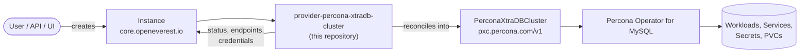

# Percona XtraDB Cluster Provider

> [!WARNING]
> **Pre-alpha.** OpenEverest v2 and this provider are under active development. CRD schemas,
> chart values and defaults change frequently, including in breaking ways, and there is no
> supported upgrade path between versions yet. Not for production use.

<!-- Remove the pre-alpha banner and the status badge at v2 GA. -->

[](https://github.com/openeverest/openeverest)
[](https://github.com/openeverest/provider-percona-xtradb-cluster/actions/workflows/ci.yaml)
[](https://pkg.go.dev/github.com/openeverest/provider-percona-xtradb-cluster)
[](LICENSE)

Run **MySQL, clustered with Percona XtraDB Cluster**, on Kubernetes through
[OpenEverest](https://github.com/openeverest/openeverest), backed by the
[Percona Operator for MySQL](https://github.com/percona/percona-xtradb-cluster-operator).

## What this is

OpenEverest providers translate a single, technology-agnostic `Instance` custom resource into
the native custom resources of an upstream Kubernetes operator — for databases, but equally
for caches, message queues, object storage, or model-serving runtimes. This repository is the
provider for **Percona XtraDB Cluster**: it owns the technology-specific knowledge —
topologies, versions, parameters, backup wiring — so that users, the API server, and the UI
stay technology-agnostic.

> [!IMPORTANT]
> **This provider is not standalone.** It requires an OpenEverest installation (core CRDs and
> controller) in the cluster. Installing this chart on its own does nothing.
> See [Install OpenEverest](https://openeverest.io/documentation/current/quick-install.html).



The provider watches `Instance` resources whose `spec.providerRef.name` is
`percona-xtradb-cluster`, and reports workload health back onto `Instance.status`. It never
manages pods directly — all lifecycle work is delegated to the operator.

## Compatibility

| provider-percona-xtradb-cluster | OpenEverest | Percona Operator for MySQL | Kubernetes |
|---|---|---|---|
| `0.5.x` | `2.0.0-alpha.1` | `1.20.x` | `1.32` – `1.34` |
| `0.4.x` | `2.0.0-dev.4` | `1.20.x` | `1.30` – `1.34` |
| `0.3.x` | `2.0.0-dev.4` | `1.20.x` | `1.30` – `1.34` |
| `0.2.x` | `2.0.0-dev.3` | `1.20.x` | `1.30` – `1.34` |
| `0.1.x` | `2.0.0-dev.2` | `1.20.x` | `1.30` – `1.34` |

## Capabilities

What you can do to a running instance through the `Instance` API. Upgrading the
provider itself is covered under [Installation](#installation).

| Capability | Status | Notes |
|---|---|---|
| Provisioning | ✅ | |
| Horizontal scaling | ✅ | `spec.components.<name>.replicas` |
| Vertical scaling (CPU / memory) | ✅ | `spec.components.<name>.resources` |
| Version upgrades | ✅ | of the deployed MySQL version — change `spec.version`; see [Versions](#versions) |
| Custom configuration | ✅ | `my.cnf` via the engine component's `configuration` parameter |
| Exposure | ✅ | `spec.components.<name>.service.serviceType`: `ClusterIP` (default), `LoadBalancer` or `NodePort`, for `engine` and `proxy` independently. `proxy.service` controls how clients reach HAProxy/ProxySQL and is how most clients should connect; `engine.service` exposes the PXC members' own Service directly, bypassing the proxy, for clients that need a direct connection to a specific node. `service.annotations` and, for `LoadBalancer`, `service.loadBalancerService.sourceRanges` are also supported on both, but only via the `Instance` spec directly — the UI doesn't expose them yet ([openeverest#1959](https://github.com/openeverest/openeverest/issues/1959), [openeverest#2398](https://github.com/openeverest/openeverest/issues/2398)) |
| Monitoring | ✅ | `spec.monitoring.destinations[]`: PMM rendered by the provider; HAProxy and `mysqld_exporter` endpoints, and the `monitor` user for agents that log in, for other monitoring classes, see [Monitoring](#monitoring) |
| TLS | ✅ | on by default; generated, cert-manager or your own certificates — see [TLS](#tls) |

Stateful workloads additionally report:

| Capability | Status | Notes |
|---|---|---|
| Persistent storage | ✅ | `spec.components.engine.storage` |
| Storage expansion | ✅ | when the StorageClass allows volume expansion |
| Backups (on demand) | ✅ | operator-native (`executionMode: ProviderManaged`) via Percona XtraBackup |
| Backups (scheduled) | ✅ | per-storage schedules on `spec.backup.storages[].schedules[]` |
| Point-in-time recovery | ✅ | one storage may enable PITR |
| Restore | ✅ | in place, and into a new Instance via `spec.dataSource` |

## Installation

The provider chart is published as an OCI artifact to GitHub Container Registry:

```bash
helm install provider-percona-xtradb-cluster \
  oci://ghcr.io/openeverest/charts/provider-percona-xtradb-cluster \
  --version 0.5.0 \
  --namespace everest-system
```

- The Percona Operator for MySQL is bundled as a chart dependency and is installed
  automatically.
- The chart records the OpenEverest it is built for, and the install fails, before anything
  is applied, when the OpenEverest in the cluster does not serve it. The error names the
  OpenEverest the chart needs; to install anyway on the OpenEverest the cluster runs, set
  `compatibility.acknowledge.coreVersion` to its version, as the error says. It also holds
  on the later OpenEverest releases that keep the same contract, such as patch releases.
- The chart sets no annotation for any tool itself: `openeverest.annotations` adds
  annotations to the `Provider` and `BackupClass`. Under Argo CD, with
  `argocd.argoproj.io/sync-wave: "-1"` for example, they sync before the provider and the
  bundled operator, so an OpenEverest that refuses them stops the sync before anything starts.
- The chart registers an admission webhook, so an invalid `Instance` is rejected when it is
  written, with every error and its field path. Its serving certificate is generated by the
  chart and kept across upgrades; set `admission.certManager.enabled=true` to have
  cert-manager issue it, or supply one through `admission.certs`. If the provider is down,
  writes are admitted and the `Instance` reports the errors in its `Ready` condition. A
  missing object the `Instance` names, such as its user Secret, is never a reason to reject
  it: `kubectl` prints a warning, and the `Instance` reports it once created.

To install from a checkout instead, `make helm-install` builds the chart dependencies
and installs it against your current kube context.

Upgrade and uninstall:

```bash
helm upgrade provider-percona-xtradb-cluster \
  oci://ghcr.io/openeverest/charts/provider-percona-xtradb-cluster --version 0.5.0
helm uninstall provider-percona-xtradb-cluster --namespace everest-system
```

Uninstalling the chart does **not** delete running `Instance` resources or their data.

## Usage

Verify that the provider registered itself:

```bash
kubectl get providers.core.openeverest.io percona-xtradb-cluster
```

Create an instance:

```yaml
apiVersion: core.openeverest.io/v1alpha1
kind: Instance
metadata:
  name: my-instance
spec:
  providerRef:
    name: percona-xtradb-cluster
  components:
    engine:
      type: pxc
      replicas: 3
      resources:
        requests:
          cpu: 500m
          memory: 2G
      storage:
        size: 10Gi
    proxy:
      type: haproxy
      replicas: 2
```

Component names are defined by this provider — see [definition/provider.yaml](definition/provider.yaml).
`proxy` is required in the `cluster` topology, with an explicit `type` (`haproxy` or
`proxysql`) and at least one replica.
`spec.version` and `spec.topology` are optional; the provider defaults apply.
More examples live in [examples/](examples/).

Watch it come up and read the connection details:

```bash
kubectl get instance my-instance -w
kubectl get instance my-instance -o jsonpath='{.status.connection}'
```

Credentials are in the secret named by `.status.connection.credentialsSecretRef`.

### Status

The provider reports what it observes, and OpenEverest derives the `Instance` conditions from
it the same way for every provider.

| Condition | What this provider reports |
|---|---|
| `Available` | `True` while the PXC nodes, and the HAProxy or ProxySQL pods in front of them, each have a pod the operator counts as ready in the `PerconaXtraDBCluster` status. Otherwise `False`, with reason `NoNodeReady` or `NoProxyReady`. The operator counts only the nodes that run the latest pod template, so early in a rolling update, before the first node has restarted, it is `Unknown` (`ReadyNodesNotCounted`) rather than `False`. It is `False` while a restore runs or the cluster is paused. |
| `Ready` | `True` once the cluster runs what the `Instance` asks for: the operator reports it ready for the latest generation of the `PerconaXtraDBCluster`, and every StatefulSet runs its latest pod template. Until then the message says what is being waited for. |
| `Restoring` | `True` while a `Restore` of the `Instance` runs, or a `PerconaXtraDBClusterRestore` created on the operator directly, and while a new `Instance` is seeded from `spec.dataSource`. |
| `Upgrading` | `True` while a new engine image rolls out. |
| `StorageResizing` | `True` while the operator grows the volumes of the PXC nodes. |

The connection details Secret is written the first time the database is available, and kept
current while a change rolls out.

Each component reports `desiredReplicas`, the pods it will have once the cluster runs the `Instance`'s current spec, defaults included: `engine` counts the PXC nodes (3 unless set), `proxy` the HAProxy or ProxySQL pods (2 unless set), and `backup`, which has no pods of its own, is not reported.

A problem makes the `Instance` not `Ready`, with a reason that says what is wrong:

| Reason | Cause |
|---|---|
| `PausedOutsideOpenEverest` | `spec.pause` is set on the `PerconaXtraDBCluster`, and neither a restore nor turning TLS on or off, for which the operator pauses the cluster itself, explains it. Nothing but unsetting it there starts the database again. |
| `AuthenticationFailed` | MySQL rejects the operator's credentials, for example because the users Secret does not match the data. |
| `ConfigurationRejected` | The operator refuses the cluster's configuration. |
| `TLSCertificatesNotReady` | The operator cannot get the cluster's certificates. |
| `ResizeFailed`, `QuotaExceeded` | The volumes of the PXC nodes could not be grown. |
| `CrashLoopBackOff`, `ImagePullBackOff`, `Unschedulable` | A pod the operator waits for during a rolling update cannot start. |
| `EngineError` | Any other error the operator reports; the message quotes it. |

Two operator errors are not problems, because the operator retries them on its next pass: a pod that takes longer than the operator's wait limit to restart, and a write that conflicted with another one. While either lasts, the `Instance` waits and says so.

What the provider cannot know:

- **Availability is as old as the operator's last pass over the cluster.** The ready counts
  are recorded then, and kept when a pass fails.
- **Operator errors are recognised by fragments of their message.** The operator has no error
  codes, so a reworded message falls back to `EngineError`. The operator records only the
  first error after a successful pass, so a later, different one shows the earlier message
  until a pass succeeds.
- **An operator error is never a terminal problem**, because the operator does not say which
  generation it is about.
- **`Upgrading` is best effort.** It is inferred from the image the nodes run, which the
  operator records only once they all run the latest pod template.

## Topologies

<!-- BEGIN GENERATED: topologies -->
| Topology | Default | Description |
|---|---|---|
| `cluster` | ✅ | Galera cluster: 3 `engine` members by default, fronted by 2 `proxy` replicas |
<!-- END GENERATED: topologies -->

The `proxy` component defaults to HAProxy; ProxySQL images are also catalogued.

## Versions

<!-- BEGIN GENERATED: versions -->
| Version bundle | Default | pxc | backup (XtraBackup) |
|---|---|---|---|
| `8.4.8` | ✅ | `8.4.8-8.1` | `8.4.0-5.1` |
| `8.4.7` | | `8.4.7-7.1` | `8.4.0-5.1` |
| `8.4.5` | | `8.4.5-5.1` | `8.4.0-5.1` |
| `8.0.45` | | `8.0.45-36.1` | `8.0.35-35.1` |
| `8.0.44` | | `8.0.44-35.1` | `8.0.35-35.1` |
| `8.0.42` | | `8.0.42-33.1` | `8.0.35-35.1` |
| `8.0.41` | | `8.0.41-32.1` | `8.0.35-35.1` |
| `8.0.39` | | `8.0.39-30.1` | `8.0.35-35.1` |
| `5.7.44` | | `5.7.44-31.65` | `2.4.29` |
| `5.7.42` | | `5.7.42-31.65` | `2.4.29` |
| `5.7.39` | | `5.7.39-31.61` | `2.4.29` |
| `5.7.36` | | `5.7.36-31.55` | `2.4.29` |
| `5.7.34` | | `5.7.34-31.51` | `2.4.29` |
<!-- END GENERATED: versions -->

Source of truth: [definition/versions.yaml](definition/versions.yaml).

MySQL only supports upgrading one major version at a time (5.7 → 8.0 → 8.4), and the operator
must already support the target version — upgrade the provider chart first.

## Configuration

- **Chart values:** [charts/provider-percona-xtradb-cluster/values.yaml](charts/provider-percona-xtradb-cluster/values.yaml)
- **Instance parameters:** per-component and per-topology `parameters` schemas, defined under
  [definition/](definition/) and published on the `Provider` resource
  (`kubectl get provider percona-xtradb-cluster -o yaml`). The provider rejects an Instance
  that does not match them, and the UI checks the form against them as you type.

The technology-specific knobs worth knowing about:

| Parameter | Applies to | Purpose |
|---|---|---|
| `configuration` | `engine` | Raw `my.cnf` configuration passed to the operator |
| `tls` | instance-wide (`spec.parameters.tls`) | TLS mode and certificate source — see [TLS](#tls) |

### Monitoring

An Instance sends monitoring data to the `MonitoringDestination`s listed in
`spec.monitoring.destinations[]`; each destination belongs to the class of an installed
monitoring extension.

- **PMM** (`pmm` class): the provider renders the operator's `spec.pmm` from the
  destination (server `parameters.url`, PMM 3 service account token under `token` in the
  credentials Secret of its `ServiceAccountToken` authentication mode) and the agent image
  of the class. The entry's `parameters.resources` override the PMM client requests sized
  from the engine memory. The destination's and the entry's parameters are decoded with the
  pmm contract module (`github.com/openeverest/monitoring-pmm/api`): a parameter it does not
  know, or a url with a path, fails rendering (Configured `RenderFailed`) instead of being
  ignored. Metrics in PMM carry `namespace` and
  `core_openeverest_io_instance` labels, plus `core_openeverest_io_component=proxy` on
  ProxySQL; HAProxy metrics are not labelled: the operator does not let the provider set
  their `pmm-admin` flags. The operator runs the PMM client with
  `PMM_AGENT_SERVER_INSECURE_TLS=1`, so it never verifies the PMM server certificate,
  whatever the destination's `spec.tls` says; the binding reports this as Configured with
  reason `AgentTLSNotVerified`.
- **Classes that scrape metrics** (Prometheus, VictoriaMetrics, …): while one is bound the
  provider runs a `mysqld_exporter` sidecar on the MySQL pods (adding or removing it restarts
  them one at a time); it connects as the operator's `monitor` user. Once the cluster is
  Ready the exporter and HAProxy's own `/metrics` endpoint are published in
  `status.monitoring.sources`.
- **Classes whose agents log in** (Releem, …): while one is bound, the provider copies the
  operator's `monitor` user (the one PMM uses: `SELECT`, `PROCESS`, `REPLICATION CLIENT`,
  `SUPER` and `RELOAD` on `*.*`) into `<instance>-monitoring-monitor`, a
  `kubernetes.io/basic-auth` Secret owned by the Instance, and publishes it under the
  `monitor` credential profile with one connection endpoint for the PXC nodes (container
  `pxc`, port `mysql`, TLS required when `tls.mode` is `requireTLS`). The users Secret also
  holds root, so it is never published itself. Every Sync copies the current password, and
  the copy is deleted once no listed destination needs it. Nothing restarts.

### TLS

TLS is on by default. Configure it with the instance-wide `tls` parameter:

```yaml
spec:
  parameters:
    tls:
      mode: requireTLS                 # preferTLS (default) | requireTLS | disabled
      # Pick one certificate source, or neither to have certificates issued:
      certificateSecretName: my-tls    # tls.crt, tls.key and ca.crt
      internalCertificateSecretName: my-tls-internal  # optional; members only
      issuer:                          # cert-manager
        name: corp-ca
        kind: ClusterIssuer            # Issuer (default) | ClusterIssuer
        group: cert-manager.io         # default; the group of an external issuer
      additionalNames:                 # DNS names clients use, besides the in-cluster ones
        - mydb.company.com
```

- **`preferTLS`** encrypts traffic between members and lets clients choose; **`requireTLS`**
  does the same and additionally sets `require_secure_transport=ON` in the engine's
  `my.cnf`, rejecting clients that don't use TLS. The operator can switch between
  `preferTLS` and `requireTLS` and toggle TLS on or off on a running cluster — it briefly
  pauses it to do so, so turning TLS on or off holds for the
  `pxc-tls-toggle` maintenance approval (a brief downtime). `disabled` turns TLS off.
- **Certificates** are, in order of precedence:
  1. your secrets: `certificateSecretName` (and optionally `internalCertificateSecretName`).
     Their subject alternative names must cover the cluster's service names
     (`<instance>-pxc`, `<instance>-haproxy` or `<instance>-proxysql`, and their wildcard
     forms). A cert-manager `Certificate` writing such a secret works, and renewals roll out
     automatically; the operator never replaces secrets it did not create itself;
  2. a cert-manager `issuer` — requires cert-manager installed in the cluster. Set `group`
     (and the matching `kind`) for an external issuer such as AWS Private CA
     (`awspca.cert-manager.io`) or Google CAS (`cas-issuer.jetstack.io`);
  3. otherwise the operator issues them: through cert-manager with a CA of its own when
     cert-manager is installed (renewed automatically), or else from a CA it generates once.

  The certificate source can't be changed after creation: a new CA would split members
  still trusting the old one.
- **`additionalNames`** adds DNS names (no IP addresses) to the issued or generated
  certificates, for clients that reach the cluster under another name, such as an exposed
  proxy behind `mydb.company.com`. It can't be combined with `certificateSecretName`, whose
  certificate carries its own names. Changing it on a running cluster reissues the
  certificates from the same issuer and restarts the pods, so it holds for a
  `tls-names-<hash>` maintenance approval (a rolling restart; see
  `status.pendingMaintenance`). That needs certificates issued by cert-manager: on a cluster
  whose certificates come from the CA the operator generated without it, the names can only
  be set at creation.
- **Clients** authenticate with their password and need only the CA to verify the cluster:
  the connection secret (`<instance>-conn`) carries it as `ca.crt`, and its `uri` sets `tls`
  to match the mode.

#### Bring your own CA

To have clients connect to `mydb.company.com` with full verification against your company CA,
give cert-manager the CA and let it sign the cluster's certificates:

```yaml
apiVersion: v1
kind: Secret
metadata:
  name: company-ca
  namespace: cert-manager          # the cluster resource namespace of cert-manager
type: kubernetes.io/tls
data:
  tls.crt: <base64 CA certificate>
  tls.key: <base64 CA key>
---
apiVersion: cert-manager.io/v1
kind: ClusterIssuer
metadata:
  name: company-ca
spec:
  ca:
    secretName: company-ca
---
apiVersion: core.openeverest.io/v1alpha1
kind: Instance
metadata:
  name: mydb
spec:
  # ...
  parameters:
    tls:
      mode: requireTLS
      issuer:
        name: company-ca
        kind: ClusterIssuer
      additionalNames:
        - mydb.company.com
```

Point `mydb.company.com` at the address clients reach the proxy on (for example its exposed
load balancer). Clients then verify the server against `ca.crt` from `mydb-conn`, for
instance `mysql --ssl-mode=VERIFY_IDENTITY --ssl-ca=ca.crt -h mydb.company.com …`.

## Development

Requires Go (see [go.mod](go.mod)), Docker, Helm, kubectl, and a Kubernetes cluster you can
reach. [dev/README.md](dev/README.md) covers the environment end to end: the recommended
local k3d setup, running against a cluster you already have, and every `dev/.env` setting.

```bash
make dev-up             # local cluster + Tilt dev environment (see dev/README.md)
make generate           # RBAC, provider spec, Helm chart sync
make run                # run the provider locally against the cluster
make test-unit
make test-integration   # chainsaw suites under test/integration/
make dev-down
```

`make help` lists every target. `make verify` fails when generated files are stale — run
`make generate` and commit the result — or when the chart is not stamped with the OpenEverest
the provider is built against, which `make generate` writes from the core `go.mod` requires.

The provider contract (`Validate` / `Sync` / `Status` / `Cleanup`), RBAC markers, watches,
code generation, and the backup/restore interfaces are documented once for all providers in
[PROVIDER_DEVELOPMENT.md](https://github.com/openeverest/provider-sdk/blob/main/PROVIDER_DEVELOPMENT.md).

### Layout

| Path | Purpose |
|---|---|
| `cmd/provider/` | Entry point |
| `internal/provider/` | `ProviderInterface` implementation, backup interfaces, RBAC markers |
| `internal/common/` | Component name constants |
| `definition/` | Provider identity, component types, versions, topologies, backup classes |
| `charts/provider-percona-xtradb-cluster/` | Helm chart (`generated/`, the `Chart.yaml` stamp and `templates/_openeverest_contract.tpl` / `openeverest-compat-check.yaml` are produced by `make generate`) |
| `config/rbac/role.yaml` | Generated `ClusterRole` — do not edit |
| `examples/` | Example `Instance` resources |
| `dev/` | Tilt dev environment, `.env` configuration, k3d cluster config |
| `.github/workflows/` | CI: lint, build, unit and integration tests, release |

### Testing

- **Unit tests** — `make test-unit`.
- **Integration tests** — `make test-integration` runs the chainsaw suites; individual suites
  are also exposed as make targets (`make test-integration-core`,
  `make test-integration-core-tls`, `make test-integration-backup`, …). The operator is
  scaled to 0 and status is simulated.
- **E2E cluster tests** — `test/e2e-cluster/` runs against a real PXC operator (`core/tls`,
  `core/tls-issuer`, `datasource/backup`). Not executed on default CI runners; use
  `make deploy-provider-e2e` then `make test-e2e-cluster` (or `make test-e2e-cluster-core-tls`
  / `make test-e2e-cluster-core-tls-issuer` for just a TLS suite; the latter installs
  cert-manager when absent) locally.
- **CI** — [.github/workflows/ci.yaml](.github/workflows/ci.yaml) runs lint, build, unit
  tests, generated-file verification, Helm lint, and each integration suite on every pull
  request.

## Troubleshooting

```bash
kubectl logs -n everest-system deploy/provider-percona-xtradb-cluster -f
```

| Symptom | Where to look |
|---|---|
| `Instance` stuck in `Creating` | `kubectl describe instance <name>` conditions, then the provider logs |
| No `Provider` resource in the cluster | Is the chart installed? Check the provider deployment logs |
| `Instance` ignored entirely | `spec.providerRef.name` must be `percona-xtradb-cluster` |
| `PerconaXtraDBCluster` created but no pods | Inspect the `PerconaXtraDBCluster` status — the failure is upstream in the operator |
| Backups never complete | Check the `Backup` resource status and the XtraBackup pod logs |

Galera requires an odd number of members; single-node clusters are development-only.

## Contributing

Issues and pull requests are welcome. See
[PROVIDER_DEVELOPMENT.md](https://github.com/openeverest/provider-sdk/blob/main/PROVIDER_DEVELOPMENT.md)
and the [OpenEverest Code of Conduct](https://github.com/openeverest/openeverest/blob/main/CODE_OF_CONDUCT.md).

## Security

Report vulnerabilities per the
[OpenEverest security policy](https://github.com/openeverest/openeverest/blob/main/SECURITY.md).
Please do not open public issues for security reports.

## License

Apache License 2.0 — see [LICENSE](LICENSE) for details.
